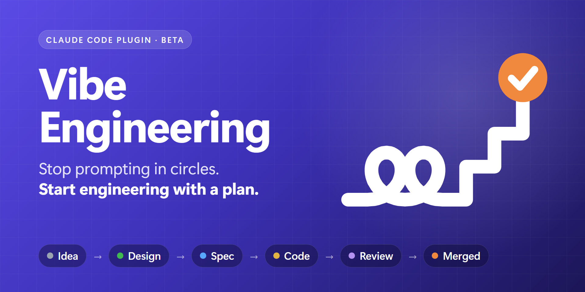
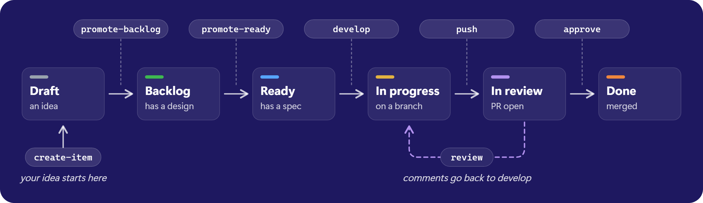

# Vibe Engineering



**The engineering process for agent-first projects.** A
[Claude Code](https://claude.com/claude-code) plugin that gives your AI agents
a workflow worth following.


[](LICENSE)

[Quick start](#quick-start) ·
[How it works](#how-it-works) ·
[Skills](#skills) ·
[Roadmap](#where-this-is-going)

---

## Why

AI writes code fast. Without a process, it also writes it in circles: one prompt
builds a feature, the next one breaks it, and a week later nobody, human or AI,
remembers why the code is the way it is.

**Vibe Engineering gives Claude a methodology for building software, not just
generating code.** Every feature lives as an item on your GitHub Projects board
and moves through the steps a good team follows: an idea, a design, a spec, the
code, a reviewed pull request. Each step writes what it learned into the item,
so the next one starts from real context instead of a fresh prompt.

| Prompting in circles | Vibe Engineering |
|---|---|
| Context lives in a chat that ends | Context lives in the board item, and every step adds to it |
| Design happens by accident, in the middle of the code | A design and a spec come before the first line of code |
| One big prompt, one big diff | One item, one small pull request |
| The AI decides, and you find out later | You approve every step: idea, design, spec, merge |
| Code that works today and nobody dares to touch | A clear architecture and consistent patterns |

**Keep the speed of AI-assisted development. Bring the discipline of software
engineering.**

## What you end up with

- **A well-configured project.** A codebase with a clear architecture and
  consistent patterns, easy to read, maintain and evolve, because the design
  comes before the code and the agent follows your repository's own rules.
- **A board that tells the story.** Each feature's idea, design, spec and pull
  request in one place, long after the chat is gone.
- **Pull requests you can actually review.** One item, one small PR, linked in
  both directions.
- **A process that doesn't depend on memory.** Any person or agent can pick up
  any item, on any day, and continue from where it stopped.

> **Beta.** This is what the full flow is designed to give you. The board and
> idea skills work today, and the rest is being built in the open:
> see [Skills](#skills) and [Where this is going](#where-this-is-going).

## How it works



- **The board is the memory.** The item carries its own idea, design and spec.
- **One Ready item is one pull request.** Planning splits the work until every
  item is small enough to build, review and merge on its own.
- **You stay in charge.** Claude asks before it moves, merges or posts anything,
  and you always say which board to use.

## Quick start

1. Install the plugin in Claude Code:

   ```bash
   /plugin marketplace add gelonezi/vibe-engineering
   /plugin install vibe-engineering@vibe-engineering
   ```

2. Create your board: *"Create a vibe-engineering board for my repo."*
3. Bring an idea: *"I think we should…"*

Not sure where to start? Ask *"How does vibe-engineering work?"* for the
illustrated guide.

### A taste

> **You:** I think we should track stock per warehouse, so I can say I have 40 kg
> of iron in Stock 01 and 20 kg in Stock 02.
>
> **Claude:** Today `Product.quantity` is a single number, and the sales screen
> subtracts from it directly. Should a sale pick the warehouse, or should the
> system choose one? And do transfers between warehouses need a record?
>
> *…a few rounds later, the idea is on your board as a Draft item, with your
> original words, the refined concept and the open questions.*

## Skills

| Skill | What it does | Status |
|---|---|---|
| `create-board` | Sets up a GitHub Projects board for iterative development: six columns, iterations, estimates and views. | ✅ Available |
| `create-item` | Talks your idea through with you, using your codebase as context, and saves it as a Draft item. | ✅ Available |
| `help` | Opens an illustrated guide to the flow, the skills and the rules. | ✅ Available |
| `update` | Updates the plugin and lists what changed. | ✅ Available |
| `promote-backlog` | Writes the high-level design and moves the item to Backlog. | 🛠️ Coming next |
| `promote-ready` | Writes the spec, sizes and splits the work, and moves it to Ready. | 🛠️ Coming next |
| `develop` | Builds the item on a branch, following your repository's own rules. | 🛠️ Coming next |
| `push` | Opens the pull request, linked to the item. | 🛠️ Coming next |
| `review` | Drafts inline review comments; you pick which ones to post. | 🛠️ Coming next |
| `approve` | Merges after checks pass and moves the item to Done. | 🛠️ Coming next |

Every skill is called as `vibe-engineering:<skill>`, but you rarely need the
name: describe what you want and Claude picks the skill.

## Where this is going

Delivering features is the first track. The goal is bigger: everything a team
needs to run an agent-first project, including people who have never worked as
software engineers.

| Track | What it gives you | Status |
|---|---|---|
| **Deliver** | A feature goes from idea to merged pull request on the board. | 🛠️ In progress |
| **Assess** | A report of what your repository is missing to work well with agents. | 🗺️ Planned |
| **Set up** | A project configured for agents: `CLAUDE.md`, rules, hooks, its own skills, a recorded architecture and quality checks. | 🗺️ Planned |
| **Start** | Repository templates that are set up correctly from day zero: a general one, .NET with Angular, TypeScript and Python. | 🗺️ Planned |
| **Guide** | A guided path for people with no software engineering background. | 🗺️ Planned |
| **Team** | Iteration planning, status reports and retrospectives for a team of people and agents. | 🗺️ Planned |
| **Trust** | Tests and evals that keep the plugin itself reliable. | 🗺️ Planned |

The full plan, with the order and the decisions behind it, is in
[docs/roadmap.md](docs/roadmap.md).

## Requirements

- [Claude Code](https://claude.com/claude-code)
- The [GitHub CLI](https://cli.github.com/), logged in with the `project` scope:

  ```bash
  gh auth login -s project
  ```

  If you're already logged in, add the scope with:

  ```bash
  gh auth refresh -s project
  ```

## Learn more

- Ask `vibe-engineering:help` for the illustrated guide.
- [docs/concept.md](docs/concept.md) explains the delivery flow, its rules and
  the design decisions behind them.
- [docs/roadmap.md](docs/roadmap.md) says what comes next.
- Found a bug or have an idea? [Open an issue](https://github.com/gelonezi/vibe-engineering/issues).

**Try Vibe Engineering. Give your AI agents a workflow worth following.**

---

## Maintainers

### Layout

```
.claude-plugin/
  plugin.json          plugin manifest: name, display name, description, icon
  marketplace.json     lets this repo be added as a plugin marketplace
  icon.png             plugin icon, 1024 px square
docs/
  concept.md           how the delivery skills work together
  roadmap.md           where the plugin is going
  images/              README banner and flow diagram
    src/               their sources, the icon's source, and render.py
scripts/               GitHub helper scripts shared by the skills
skills/
  <skill-name>/
    SKILL.md           instructions Claude follows
    references/        specs and docs the skill reads when needed
    scripts/           helper scripts only this skill uses
    assets/            files the skill shows the user, such as the help page
```

### Releasing a change

1. Bump `version` in `.claude-plugin/plugin.json` and in the version badge above.
   `vibe-engineering:update` reports the installed and published commits, and
   tells the user how to force a reinstall when a push didn't come with a bump.
2. Keep `README.md`, `docs/concept.md`, `docs/roadmap.md` and
   `skills/help/assets/help.html` in step: the help page is written by hand and
   says which skills exist.
3. The plugin's `description` and `displayName` appear in both `plugin.json` and
   the entry in `marketplace.json`. The marketplace entry wins where they differ,
   so change both together.
4. Run `claude plugin validate . --strict` before pushing.

### Images and icon

The banner, the flow diagram and the icon are drawn as HTML and SVG in
`docs/images/src/`. After editing a source, render it again:

```bash
python docs/images/src/render.py
```

It needs Chrome or Edge, and Python with Pillow. Anthropic's plugin directory
keeps the icon from the first submission, so settle it before submitting.

### The board template

`vibe-engineering:create-board` copies
[project 4 in the `gelonezi` account](https://github.com/users/gelonezi/projects/4),
which was made from GitHub's built-in **Iterative development** template, with a
Draft column added. It's public, so keep it free of real work. Changes made there
reach new boards only.

To copy a different project, set `VIBE_ENGINEERING_TEMPLATE_OWNER` and
`VIBE_ENGINEERING_TEMPLATE_NUMBER`.

## License

[MIT](LICENSE) © 2026 Rogerio Gelonezi
